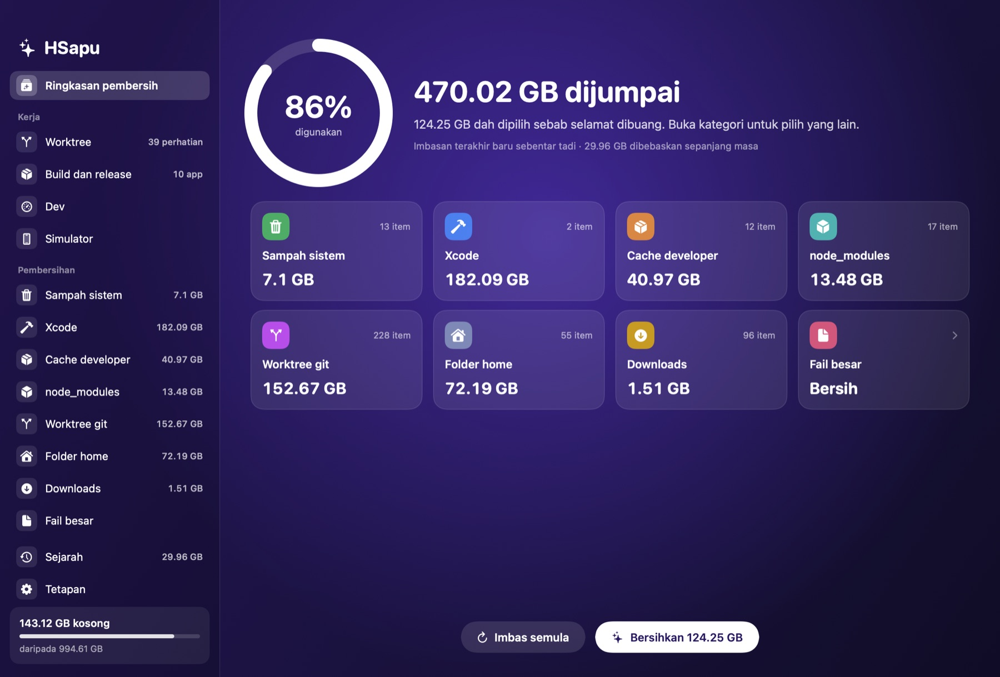

<div align="center">

# HSapu

**Mac cleaner and developer workspace hub.**
Clear caches, build leftovers, `node_modules`, git worktrees and simulator data safely, with a preview before anything is removed.

[](https://terascore.my/hsapu/)
[](https://github.com/terascoremy/HSapu/releases)


**[Website](https://terascore.my/hsapu/)** | **[Release notes](https://github.com/terascoremy/HSapu/releases)** | **[Feedback](https://github.com/terascoremy/HSapu/issues)**



</div>

## Highlights

- **Cleaner.** System caches, Xcode, developer caches, `node_modules`, git worktrees, home folders, Downloads and large files. Every item has a safety level, a preview before delete and an option to send it to the Trash.
- **Workspace.** A worktree manager, a build and release tracker (version, build number, CI status) and a developer dashboard for Docker, simulators, emulators and disk.
- **Simulators.** Runtimes and devices with their size: erase, delete or shut down.
- **History.** Every action is recorded, grouped by day, with a chart of space freed.
- **Background.** Menu bar icon, low disk space notifications and scheduled scans.
- **Private.** No account and no analytics. The only network request is the update check on GitHub.

## Build

```bash
swift build                    # debug
./build_app.sh                 # build/HSapu.app (universal)
```

The version lives in `Sources/HSapu/Version.swift` only.

## Tests

```bash
.build/debug/HSapu --selftest        # cleaning and worktrees
.build/debug/HSapu --selftest-core   # caches, exclusions, history, simulators, updates
.build/debug/HSapu --scan [--big] [--all]   # scan without the GUI
.build/debug/HSapu --check-update [version] # check GitHub for a newer release
```

## Get HSapu

HSapu is downloaded from **[terascore.my/hsapu](https://terascore.my/hsapu/)**. Open the disk image and drag HSapu into Applications. It is signed and notarized by Apple.

**Requirements:** macOS 14 Sonoma or later, Apple silicon or Intel.

## Updating

This repository hosts the update packages. In HSapu, open **Settings, Kemas kini, Semak sekarang**. If a newer release exists you will see its version and notes, and the update is downloaded, checked against its checksum, installed and the app reopens.

## Releasing

1. Raise `appVersion` in `Sources/HSapu/Version.swift` and add a `CHANGELOG.md` entry.
2. `./scripts/release.sh --publish "notes"` builds, notarizes, publishes the update zip and checksum to GitHub and writes `dist/HSapu-<version>.dmg` and `dist/HSapu.dmg`.
3. Upload the DMG to `terascore.my/hsapu/files` (not to GitHub).

---

<div align="center"><sub>Made by Teras Core Technology Sdn. Bhd. HSapu is an independent project and is not affiliated with Apple.</sub></div>
